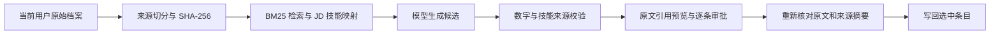
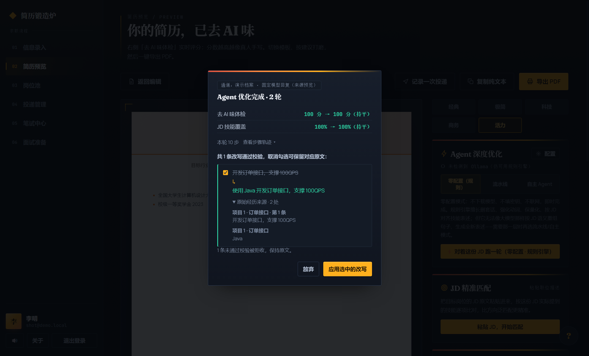

# 用户经历检索与改写溯源（第三步，2026-11-02）

检索已进入简历改写链路：原始档案提供事实来源，校验门附加可核对的引用，用户在预览中逐条审批，应用时再次检查来源。48 次真实流水线对照中，qwen3:8b 的有来源目标技能表达为检索组 8/9、无检索组 0/9；qwen2.5:1.5b 两组均 0/9。

统一指标在 [baseline.json](../benchmarks/baseline.json) 的 `agent.resumeEvidenceComparison`，逐次响应、拒收、token、来源与步骤在 [1.5B 原始报告](../benchmarks/resume-evidence.json) 和 [8B 原始报告](../benchmarks/resume-evidence-8b.json)。

## 来源怎样进入改写



1. `src/main/resume-evidence.ts` 每次运行只索引传入档案：简介、技能、项目／实习名称和技术、描述行、教育、奖项。不索引联系方式，不跨账号缓存来源正文。
2. 每个来源带 `id/path/label/scope/text/digest`。例如 `p0-tech` 对应 `projects[0].tech`；`p0-b0` 对应第一条项目描述。描述中的行号来自引擎归一化切分，数组和多行字符串使用同一规则。
3. 流水线自动检索；自主工具集新增 `retrieve_profile_evidence(query, topK)`。默认 BM25 topK=6，允许 1–10；项目只能引用同项目，实习只能引用同实习。个人技能清单、别的项目和题库材料不能代替当前项目的经历依据。简介可汇总档案检索命中。
4. 模型输入同时带来源及“有用户经历证据的 JD 技能”映射。JD 与来源文本被标为数据，提示词要求只改写目标 ID；模型自行生成的引用不被信任。
5. `validateRewrites` 保留已有套话、长度和评分校验，要求原文阿拉伯数字 token 保全；新增数字也必须在允许的来源中出现。显式“从／由…到／至”、箭头、英文 `to` 和优化前后标签的数值关系要保留，新增关系也须来自同一条允许引用的来源；`800ms→120ms` 不能反转为 `120ms→800ms`，增减方向也不能反转。独立数字可调整句子顺序，明确前后标签时可先写结果。Redis、Docker、Vue 等具体技术检查字面及有限别名，避免把“缓存”当成实际使用 Redis 的证明。
6. 校验门给接受项附目标原文，以及支持新增技能／数字的实际来源。预览展开“原始经历来源”可看到原文片段和经历标签；引用片段最多 300 字，摘要覆盖完整归一化来源。运行记录的结果摘要只新增来源 ID 与 digest，不保存引用正文；工具轨迹继续使用既有脱敏规则。
7. `applyRewritesToProfile` 要求每条候选带来源，重新检查引用位置、原文片段、摘要和目标旧文，再通过同一校验门。删除或清空来源、原始技术或描述变化、伪造摘要、跨项目引用会被拒绝。

2026-11-03 补充修复：退出、切换账号或恢复无效会话会撤销当前窗口的会话并取消旧运行；旧进度、流式片段和最终候选不传给新账号。`rewrite_bullets` 设置 `cacheResult: false`，每次提交都读取当前检索证据重新校验；`idempotent: true` 继续允许异常重试。补检索后，相同候选可以重新接受。

随后补齐流水线用量与预算：Ollama NDJSON、OpenAI 兼容 SSE 及普通 JSON 响应均透传服务端用量；同一请求多次累计上报只取最新值，再累计各轮。流水线结果、运行记录和模型 trace 保存实际 token，达到 `maxTokens` 即中断当前请求，不再发起下一轮，并保留之前已通过的候选。服务只在尾帧上报时，在收到用量后停止后续工作；未上报时 trace 为 `null`，不估算。`stream_options` 不被兼容服务接受时，去掉可选参数重试。



截图使用演示档案和固定模型回复，通过真实运行逻辑和真实 DOM 渲染；它用于核对交互和布局，真实模型效果来自上面的原始报告。

## 对照方法

固定用例包括 Redis 缓存、Vue 页面、Excel 报表，以及其他项目有 Docker、当前订单项目没有 Docker 的负例。前三例的技术在当前项目 `tech` 字段中，原始目标描述没有该技术名。每模型、每检索模式、每用例重复 3 次，共 48 次；每组 12 次运行，目标技能指标的分母为前三例的 9 次。

| 模式 | 模型可见依据与校验依据 |
|---|---|
| none | 目标描述原文；检索结果和技能映射为空。其他技术字段不能凭 JD 猜测后直接写入 |
| bm25 | 目标原文＋检索命中＋同经历的有来源 JD 技能映射 |

这是“检索＋有来源技能映射＋校验”整条链路的对照，没有单独分离 BM25 和技能映射的贡献。none 下即使模型猜中了技术名，若目标原文没有该技术依据，校验仍会拒收；因此技能指标衡量最终的有来源表达，不是模型记住技术名的能力。

温度 0.3，最多 2 轮，运行期限 60 秒，使用服务默认上下文；none/bm25 的顺序按重复次数交替。只执行流水线真实模型对照，自主路径的来源行为由回归测试验证；自主真实模型检索对照未执行。

## 真实结果

| 模型 | 检索模式 | 运行成功 | 目标技能表达并引用同项目技术 | 接受条目覆盖率 | 来源可重新核对 | 平均耗时 | 平均 token |
|---|---|---|---|---|---|---|---|
| qwen2.5:1.5b | none | 12/12（100%） | 0/9（0%） | 80% | 100% | 275 ms | 551 |
| qwen2.5:1.5b | bm25 | 12/12（100%） | 0/9（0%） | 100% | 100% | 299 ms | 989 |
| qwen3:8b | none | 11/12（91.7%） | 0/9（0%） | 73.3% | 100% | 11716 ms | 1116 |
| qwen3:8b | bm25 | 12/12（100%） | 8/9（88.9%） | 80% | 100% | 12799 ms | 1502 |

运行成功按引擎 `ok` 计数，表示这次运行完成并有可用改写；成功与全部条目改写、目标技能表达分别计量。来源可核对的分母是接受项；无检索接受项也会引用目标原文。条目覆盖率包含负例的两个项目，不等于目标技能表达率。token 均来自服务回报，每组覆盖率 100%，延迟含各次请求及重试。

1.5B 两组分别接受 12、15 条，8B 分别接受 11、12 条；所有接受项的原文数字丢失为 0，命中用例标注无证据技能的接受项为 0。这个检查只覆盖用例的有限标注。8B none 前端第 2 次输出 Vue，但目标原文只有页面描述，来源门拒收，整次没有接受项；bm25 组 3 次前端都通过并引用 `p0-tech`。

8B 检索组缓存第 1 次：原文“负责缓存模块开发，响应从 800ms 降至 120ms”，技术来源“Java、Redis”，最终“开发基于Redis的缓存模块，响应时间从800ms降至120ms”。第 3 次缓存输出没有表达 Redis，因此该次目标技能指标计失败，运行本身仍成功。

1.5B 即使看到检索来源和技能映射，也未在目标描述中使用 Redis/Vue/Excel；条目覆盖率增加不能据此声称目标技能表达改善。第一轮仅加入来源、尚未加入技能映射的实验同样保留在 [历史报告](../benchmarks/history/resume-evidence-before-hints-2026-11-02.json)，它使用 rewrite-rules-v2，不能与当前 v3 混作同一轮结果。

两模型均为 Q4_K_M，服务为 Ollama 0.40.7；模型系列和 thinking 能力不同，本对照支持具体配置下的结论。每组样本有限，报告里的 Wilson 区间描述固定用例重复运行的成功率，不能用成功率区间代替技能表达率区间。

## 复现与代码版本

以下 PowerShell 命令本次已执行；对应端点需包含指定模型：

```powershell
Set-Location C:\trae\resume-app
npm run build
node evals/resume-evidence-eval.js --self-test --sample 1
$env:AGENT_BENCH_ENDPOINT = 'http://127.0.0.1:11434'
$env:AGENT_BENCH_MODEL = 'qwen2.5:1.5b'
node evals/resume-evidence-eval.js --sample 3
$env:AGENT_BENCH_ENDPOINT = 'http://127.0.0.1:11435'
$env:AGENT_BENCH_MODEL = 'qwen3:8b'
node evals/resume-evidence-eval.js --sample 3 --output benchmarks/resume-evidence-8b.json
npm test
npm run smoke:ipc
npm run smoke:ui
node scripts/baseline.js --llm
```

两报告的固定输入 SHA-256、当时的提示词版本和实际执行核心模块一致；源码快照的唯一内容差异是评测脚本增加输出路径参数。评测时 HEAD 为 4cf79ab，工作区有未提交修改，因此复现以报告引用的执行源码快照为准：

- [1.5B 执行快照](../benchmarks/source-snapshots/51434fb61d8d04ec.json)
- [8B 执行快照](../benchmarks/source-snapshots/ea75d9ec489a21dd.json)
- [固定用例](../evals/resume-evidence-cases.js)、[评测脚本](../evals/resume-evidence-eval.js)

提示词为 rewrite-system-v1、rewrite-rules-v3、agentic-system-v3。快照保存已加载的项目模块、提示词和依赖清单，各文件带文本与 SHA-256；模型权重指纹、服务版本、原始输入及运行环境保存在报告中。

## 验证与仍需人审的部分

全量回归为 1,715 条断言、30 个基线脚本、0 失败；Python 29 项、规则层 32/32、mock 72 用例门禁通过。来源专项 49 项和应用渲染 38 项包含在全量断言中。真实 IPC 140 项通过，覆盖两种模型运行模式下的退出、直接切换账号和无效会话恢复，以及流水线 SSE 用量、预算中断与数字关系核验；界面管线 210 项通过、20 张截图，来源图已核对。IPC 中模型用固定 SSE 回复，界面用固定回复，两者均不计入真实模型的 48 次。

v1.15.1 的应用提交同步完成来源／数字复核、改写前快照和档案保存，拒收账号变化及存档版本变化后的请求。IPC 回归另覆盖快照隔离、内嵌推理 signal 取消、取消后队列恢复与实际 token；单元回归覆盖云端收到响应头后的正文取消／超时、数字符号和指标归属。内嵌桥使用推理替身验证，真实 GPU 推理未执行。

来源摘要一致只证明引用仍对应当前档案。有限技能别名、阿拉伯数字和显式前后关系检查无法判断完整语义：多个指标的语义归属、中文数字、职责升级、同一项目不同阶段的事实关系、未收录技能仍需人工核对。例如历史 8B 接受项出现“独立完成”“整理并分析”，原文未明确独立承担或分析职责；本版校验门不会识别这些变化。

旧结果没有 evidence 时拒绝应用，需要重新运行优化生成带来源的候选。大档案中 topK 截断可能漏掉合理依据而误拒；误拒率、更多岗位的标注集、来源提示注入及职责语义的专项评测尚未执行。真实世界经历是否属实也需要用户核对。第二步 [双模式历史基线](./real-model-eval.md) 继续保留，第三步没有重新跑其旧用例集。上面 48 次真实模型结果对应报告中的执行源码快照；2026-11-06 修复后的真实模型评测未执行。
